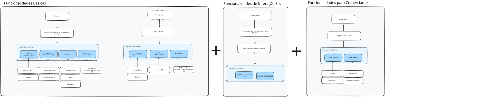

# Porto: uma só app para viver a cidade

Projeto das cadeiras de **Computação Móvel** e **Conceção de Interfaces para Aplicações Móveis** (UMAIA).

## Estrutura do repositório

| Pasta | O que contém |
|---|---|
| 📋 [`interview/`](interview/) | Guião de entrevista aos munícipes e as 6 entrevistas realizadas (SIM-01 a SIM-06) |
| 📱 [`mockups/`](mockups/) | Ecrãs da app e diagramas de fluxo (Excalidraw + imagens) |
| ✏️ [`scrath/`](scrath/) | Rascunhos e esboços iniciais (inclui o fluxo de uso) |
| 📄 [`relatorio/`](relatorio/) | Relatório final do projeto |
| 💻 [`src/`](src/) | Código-fonte da app (a desenvolver) |

Cada pasta tem o seu próprio `README.md` a explicar os ficheiros.

## Sobre

O Porto já tem muitos serviços digitais (Agenda Porto, Portal do Munícipe, Porto.CARD, Metro, Águas e Energia), mas cada um funciona sozinho. Este projeto propõe uma app que **não os substitui**: junta-os numa única experiência, adaptada a cada utilizador. A mobilidade liga tudo: a app sabe onde precisas de estar e ajuda-te a chegar a tempo.

## Utilizadores

- **Residente:** login com Chave Móvel Digital ou Cartão Municipal. Eventos, cartões digitais, serviços municipais e mobilidade.
- **Não residente:** login com conta. Eventos, Porto.CARD e mobilidade.
- **Tripeiros (amigos):** ver onde estão os amigos no mapa e os eventos a que vão.
- **Comerciantes:** criar eventos e ofertas (pop-ups, workshops, happy hours).

## Fluxo de uso

## Estado

Conceito e protótipo de interface. Não há implementação funcional nem integração real com os sistemas existentes. As integrações (Agenda Porto, Metro/STCP, Chave Móvel Digital) estão **por validar**.

## Autores

[Marcelo Pinto] · [2026/2027]
